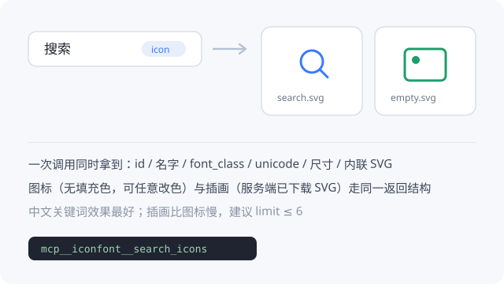

# iconfont 图标搜索

把 [iconfont.cn](https://www.iconfont.cn/)（阿里矢量图标库）的公开搜索接成模型工具
`mcp__iconfont__search_icons`：给一个关键词，拿回可直接落盘的 SVG。

## 什么时候用它

- 做界面/图标时**别再自己手画 SVG**，先搜一下社区里有没有现成的。
- 需要配图、空状态插画时用 `type: "illustration"`。
- 需要"线性/面性"等风格统一时用 `style` 筛选。

## 怎么调

| 参数 | 必填 | 说明 |
|---|---|---|
| `q` | ✅ | 关键词。**中文效果最好**（iconfont 的标签以中文为主） |
| `type` | ✅ | `icon`（单色字形，做 UI）或 `illustration`（场景插画） |
| `limit` | | 1~60，默认 20。**插画建议 ≤6**（服务端要逐个下载 SVG） |
| `sortType` | | `updated_at`（默认）或 `popular` |
| `fills` / `line` / `fill` / `flat` / `hand` / `simple` / `complex` | | 风格筛选，`"1"` = 要求，`""` = 不限 |

返回：`total` + `hits[]`，每条含 `id` / `name` / `font_class` / `unicode` / `width` / `height` / `svg`。
插画的 `svg` 由服务端带 Referer 下载后内联；拿不到时为 `null`。

## 这个包是怎么来的（⚠ 与社区原版有一处不同）

- 服务端本体是社区包 **`@dawipong/mcp-iconfont@0.3.1`**（MIT，作者 nvrenshiren），
  vendor 在本工作台的 `MCP\mcp-iconfont\`，**没有改它的业务逻辑**。
- **唯一补丁**：iconfont 的搜索接口现在要求请求带 `Cookie: ctoken=null`
  （只把 `ctoken` 放表单字段已经不够）。原版不发这个 Cookie ⇒ 一调就 `403 Redirecting to /`。
  补丁由 `工具\mcp-iconfont补丁.mjs` 从原始基线 `.orig` **重新生成**，可 `--restore` 回滚。
  判据是"两个搜索请求都带 Cookie"，只补一处会被判不合格。
- **包升级后必须重跑**：`node 工具\mcp-iconfont补丁.mjs`（`dist\iconfont.js` 是生成产物）。

## 已知限制

- 依赖 iconfont 的**非公开文档化**接口，上游随时可能再变；再变时 `mcp-iconfont补丁.mjs --check` 会报出来。
- 插画搜索慢、返回大，别一次要几十个。
- 拿到的是 SVG 源码，**不会**自动落盘 —— 要存文件仍需自己写。
- `illustration_3d` 类型没有 SVG，返回 `svg: null`。
